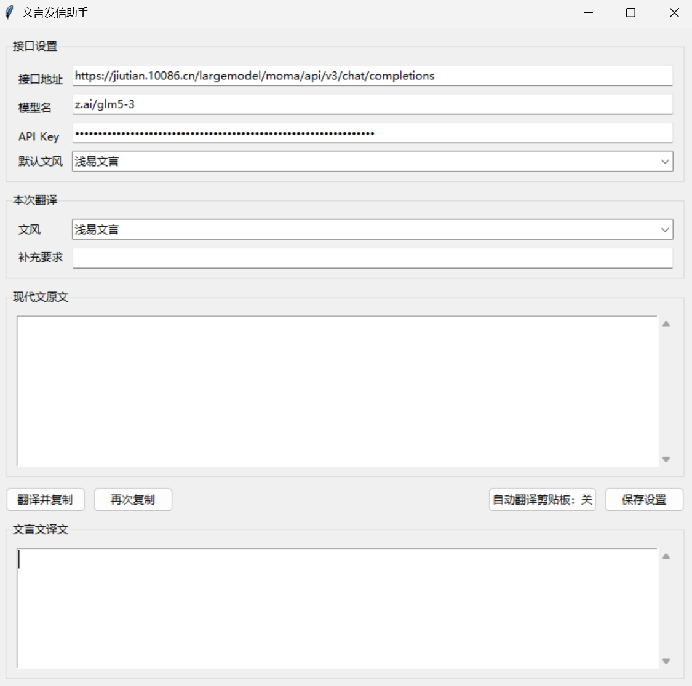

# WenyanTranslator 文言发信助手

**作者**：陈桢一（2600013636） 工学院
**项目类型**：Windows 桌面工具 / 现代汉语到文言文转换
**仓库**：<https://github.com/benzhenpku/WenyanTranslator>
**最终版本**：v2.0（具体 commit 见仓库标签与提交记录）

## 一、项目背景与目标

在微信、QQ 等聊天软件中，偶尔把现代汉语改成文言文会增加表达的趣味，也能作为古典语文学习的辅助练习。手工翻译既慢又容易前后风格不一致，因此本项目把"调用大模型翻译、检查错误、复制到剪贴板"串成一个可重复使用的桌面流程。

项目目标：

1. 提供浅易、典雅、庄重、艰深古奥四种文风。
2. 将现代文粘贴到窗口后翻译，成功时自动复制译文。
3. 支持补充要求，例如"保留人名和数字""不要使用生僻字"。
4. 保留换行、数字、专有名词等关键信息，不输出解释或多余前缀。
5. 将 API 配置保存在项目目录，不把密钥写入仓库。

本项目**不会自动发送消息**。它只生成并复制译文，发送动作仍由用户在聊天软件中完成；快捷替换也只是模拟键盘操作，不会绕过聊天软件的发送确认。

## 二、功能概览

- 原文输入与译文输出均为可滚动的纯文本框。
- 支持四种文风：
  - **浅易文言**：清楚易懂，少用生僻字。
  - **典雅文言**：措辞雅洁，略带古典韵致。
  - **庄重文言**：语气庄重，句法谨严。
  - **艰深古奥**：使用生僻字、古字、典故和先秦两汉式句法，但保持可断读。
- 翻译成功后自动写入剪贴板，并提示"已复制，可粘贴到聊天框"。
- "再次复制"按钮方便在复制其他内容后重新取回译文。
- 可开启"自动翻译剪贴板"：复制一段新文字后自动翻译并更新剪贴板。
- 快捷替换（可选增强）：在微信 / QQ 输入框选中文字后按 `Ctrl+Alt+M`，程序自动复制、翻译并粘贴回输入框，发送仍由用户手动完成。
- 设置可保存并自动恢复：接口地址、模型名、API Key、默认文风、默认补充要求。
- 网络错误、HTTP 错误、超时、响应 JSON 异常、空译文都有明确提示。

## 三、课程知识与核心设计

### 3.1 模块结构

项目刻意把核心逻辑和界面分开，便于测试和复用：

```text
WenyanTranslator/
├── src/
│   ├── core.py                 # 提示词、接口地址规范化、HTTP 调用与响应解析
│   ├── config_store.py         # 配置读写、日志、读取 CC Switch 接口配置
│   ├── win32_utils.py          # Windows 窗口、键盘输入和线程消息工具
│   ├── gui.py                  # tkinter 界面、线程协调、剪贴板与快捷替换
│   └── __init__.py
├── wenyan_translator.pyw       # 极薄的启动入口
├── tests/
│   └── test_wenyan_translator.py    # 接口、提示词、异常、配置与边界测试
├── examples/
│   ├── sample_input.txt
│   ├── sample_output.txt       # 真实接口运行得到的四文风样例
│   └── config.example.json     # 不含 API Key 的配置字段示例
├── docs/
│   └── screenshot_main.png     # 实际运行截图
├── README.md
├── README.html             # README 的网页版
├── requirements.txt
├── start.bat
├── LICENSE
└── .gitignore
```

`core.py` 不依赖 tkinter，因此可以单独导入和测试；GUI 只负责采集配置、调度后台任务和展示结果。这一划分避免了"所有逻辑都写在按钮回调里"的常见问题。

### 3.2 提示词与文风选择

`STYLES` 是一个字典，保存"文风名称 -> 文风说明"的映射。选择文风时通过 `dict` 查找，时间复杂度为 **O(1)**；未知文风会回退到默认文风。构造用户提示词时，把文风说明、补充要求、原文放进带标签的文本块：

```text
文风：典雅文言
文风说明：措辞雅洁，结构工整，略带古典韵致。
补充要求：无

现代文原文：
<original_text>
……
</original_text>
```

系统提示词要求模型只返回译文，不添加解释、标题、引号或代码块，并明确要求保留人名、地名、数字、标点和段落换行。这样可以把"格式约束"和"本次内容"分开，减少把提示词误当成正文的风险。

### 3.3 HTTP 请求与 JSON 解析

项目只使用 Python 标准库 `urllib.request`，不引入第三方依赖。请求流程为：

1. `normalize_endpoint()` 补全 `/chat/completions`；
2. 将模型名、系统提示词、用户提示词、`temperature`、`reasoning_effort` 序列化为 UTF-8 JSON；
3. 以 `Authorization: Bearer <API Key>` 发送 POST；
4. 解析 `choices[0].message.content`，去掉首尾空白；
5. 将可向用户解释的异常统一包装为 `TranslationError`。

构造请求和读取响应的主要工作量与输入长度 **n** 成正比，即 **O(n)**。项目不把 API Key 写进代码、README、测试或 Git；它只保存在本地 `config.json`，该文件已被 `.gitignore` 排除。

### 3.4 线程与事件队列

一次翻译可能需要数秒。如果把 HTTP 调用直接放在 tkinter 主线程，窗口会卡住，用户无法拖动或点击。程序采用：

- `threading.Thread` 在后台执行 HTTP 请求和 JSON 解析；
- 后台线程完成后调用 `root.after(0, 回调, 结果, 错误)`，把回调交给 tkinter 主循环；
- 回调在主线程中执行，由它更新文本框、按钮状态和剪贴板。

这样 GUI 的 Tk 对象始终只在主线程中访问，避免跨线程直接操作界面造成随机崩溃。快捷替换时，全局热键线程收到热键消息后同样只调用 `root.after(...)`，窗口切换和剪贴板操作都由主线程完成。

### 3.5 Windows API 交互

快捷替换是可选增强功能，涉及以下 Win32 API：

- `RegisterHotKey` / `GetMessageW`：注册和接收 `Ctrl+Alt+M`；
- `GetForegroundWindow`：识别当前聊天窗口；
- `AttachThreadInput`、`SetForegroundWindow`、`SetFocus`：切换窗口焦点；
- `SendInput`：模拟 `Ctrl+C`、`Ctrl+A`、`Ctrl+V`。

程序使用 `RegisterHotKey` 而不是低级键盘钩子，因为后者在部分环境中会因权限或安全软件失败。快捷键注册失败不会影响核心翻译流程，界面会显示失败状态并提示仍可手动翻译。

### 3.6 配置持久化与安全

配置文件位于项目根目录：

```text
WenyanTranslator/config.json
```

该文件已被 `.gitignore` 排除，即使误执行 `git add .` 也不会把 API Key 放进版本历史。

此外，程序启动时如果检测到本机安装了 CC Switch（存在 `~/.cc-switch/cc-switch.db`），会读取其中当前启用的 Codex 服务商的接口地址、模型名和 API Key，并覆盖界面中的接口设置；关闭窗口时这些设置会随其他配置一起写入本地 `config.json`。未安装 CC Switch 时该步骤自动跳过。

配置读写使用 `json`。读取时只保留已知字段，遇到损坏 JSON 或非对象数据会回退到默认值；写入时直接覆盖。配置读写的时间复杂度与字段数量成正比，字段数固定，因此可视为 **O(1)**。

## 四、安装与运行

### 4.1 环境要求

- Windows 10 或更高版本
- Python 3.10 或更高版本
- Windows 官方 Python 安装包（自带 tkinter）

本项目不需要 `pip install`，没有第三方运行依赖。`requirements.txt` 中明确写明这一点。

### 4.2 运行方式

在项目根目录双击：

```text
start.bat
```

或使用命令行：

```powershell
pythonw wenyan_translator.pyw
```

首次启动后，在"接口设置"中填写：

- 接口地址（OpenAI 兼容的 Chat Completions 地址，或可自动补全的 base URL）；
- 模型名；
- API Key；
- 默认文风。

点击"保存设置"。程序下次启动会从 `config.json` 恢复这些设置。

字段格式可参考 `examples/config.example.json`。示例文件故意保留空 `api_key`，不能直接用于请求；真实配置只保存在本地，不进入仓库。

### 4.3 最小示例

输入：

```text
我今晚不吃饭了。
```

选择"浅易文言"，点击"翻译并复制"，程序会得到类似：

```text
吾今夕不食矣。
```

并自动复制到剪贴板。回到微信或 QQ 输入框按 `Ctrl+V` 后手动发送即可。

## 五、功能展示

### 5.1 主界面截图



截图展示了程序实际运行时的界面。API Key 在界面中以圆点遮罩显示，没有在仓库中保存或展示真实密钥。

### 5.2 四文风真实输出

输入见 `examples/sample_input.txt`，以下是 2026-10-20 使用 GLM 5.3 兼容接口得到的真实输出（每次生成可能有细微差异）：

| 文风 | 实测耗时 | 输出 |
|---|---:|---|
| 浅易文言 | 2.53 秒 | 吾今夕不食矣。依昨日会议所定，吾等下周先毕项目风险评估之事，再议立项与否。同僚言其今日告假，因子患病。 |
| 典雅文言 | 2.73 秒 | 吾今夕不食矣。谨依昨日会议之议，吾等来周先竟项目风险评估之事，而后定立项与否。同僚言今日告假，盖稚子抱恙故也。 |
| 庄重文言 | 3.74 秒 | 吾今夕不食矣。依昨日会议所决，吾等于下周先竟项目风险评估之事，而后定其立项与否。同僚言今日告假，以其子抱恙故也。 |
| 艰深古奥 | 2.91 秒 | 吾今夕辍飧矣。昨日之议既决：来旬吾侪当先竟项目度险之事，而后决其立与弗立。同僚言其今日告假，以稚子婴疾故也。 |

完整的分段结果见 `examples/sample_output.txt`。项目同时保留真实端到端测试记录：在桌面窗口中输入"我今晚不吃饭了，明天再联系。"，点击翻译后界面状态为"已复制，可粘贴到聊天框。"，译文为"吾今夕不食矣，明日再会。"，剪贴板内容与译文一致。

## 六、测试与结果

### 6.1 自动化测试

运行命令：

```powershell
python -m unittest discover -s tests -v
```

2026-10-22 实际运行结果：

```text
Ran 17 tests in 0.018s
OK
```

测试覆盖：

| 类别 | 覆盖内容 |
|---|---|
| 接口地址 | 完整地址、base URL、末尾斜杠、空白 |
| 文风字典 | 四种文风都存在、说明非空 |
| 正常请求 | HTTP 请求体、模型名、`reasoning_effort=high`、译文去空白 |
| 边界情况 | 空译文、缺少 `choices` |
| 异常情况 | HTTP 401、网络不可达、响应格式异常 |
| 配置 | 默认值（不读取本机真实配置）、写入后读取内容一致 |
| 系统提示词 | 只返回译文、保留人名地名、保留换行 |

### 6.2 手动功能测试

| 用例 | 操作 | 实际结果 |
| --- | --- | --- |
| 启动 | 双击 `start.bat` | 窗口正常打开 |
| 保存设置 | 填写接口信息后点击保存 | 状态栏提示"设置已保存。" |
| 正常翻译 | 输入现代文并点击"翻译并复制" | 真实接口返回译文，剪贴板同步更新 |
| 空输入 | 不输入内容直接翻译 | 提示"请先输入要翻译的现代文。" |
| 错误 Key | 使用无效 Key 请求 | HTTP 错误被转换为可读提示，剪贴板不被改写 |
| 断网/错误地址 | 使用不可达地址 | 提示无法连接接口 |
| 多段文本 | 输入三段带换行的文字 | 输出保留分段结构 |
| 四文风 | 分别选择四个文风 | 输出风格可区分，见上表 |

### 6.3 性能观察

模型服务本身会受网络、排队和负载影响，不能把一次耗时当作固定指标。本项目没有使用 `low` 推理，因为实测中低推理更容易丢掉段落和风格要求；`medium` 在本机测试中反而出现过 9–24 秒的慢响应。最终统一使用 `reasoning_effort=high`，在同日四文风真实测试中约 2.5–3.7 秒完成。

## 七、局限与改进

### 7.1 已知局限

1. **依赖外部服务**：需要网络、有效的 OpenAI 兼容接口和模型配额；接口不可用时无法离线翻译。
2. **仅支持 Windows**：Win32 API 部分（快捷键、窗口焦点）只在 Windows 上有效；核心翻译模块本身可以跨平台复用。
3. **只处理纯文本**：不处理图片、文件、表情包、语音或富文本格式。
4. **译文质量依赖模型**：古文用典和专有名词可能有误差，发送前应由用户检查。
5. **没有本地缓存**：重复文本会再次请求接口，可能增加费用和时间。

### 7.2 改进方向

1. 增加 SQLite 本地缓存，按"原文 + 文风 + 补充要求"缓存译文。
2. 增加批量翻译和导出 Markdown 的功能。
3. 提供可编辑的文风模板，让用户自定义"浅易/典雅/庄重/艰深"的具体约束。
4. 增加请求取消、超时重试和接口健康检查。
5. 对输出做专有名词和数字校验，必要时提示用户人工复核。

## 八、来源与 AI 使用声明

**使用工具**：OpenAI Codex CLI（GPT 模型）、Qoder 智能体，用于代码生成、重构、测试编写和文档排版建议。

**AI 参与的环节**：

- 项目结构拆分与模块接口设计；
- 核心代码的编写与重构；
- 单元测试用例编写和真实接口验收命令；
- README、课程报告、演示说明和截图的整理。

**本人完成的设计、取舍与验收**：

- 提出"把现代文转换为文言文并复制到聊天框"的选题和使用场景，明确程序只生成译文，不代替用户发送消息；
- 确定浅易、典雅、庄重三种基础文风，并要求增加生僻字较多的"艰深古奥"模式；
- 要求主界面保持可见、不设置开机自启动，并把聊天软件快捷替换限制为可选增强；
- 提出速度与质量兼顾的目标；AI 比较推理参数后采用 `reasoning_effort=high`，并报告四文风实测结果；
- 对提交范围、功能边界和密钥安全提出要求，确认仓库不包含真实 API Key。

**代表性协作记录**：

1. **界面与启动方式调整**：本人明确要求主界面保持可见、不后台隐藏、不设置开机自启动。AI 据此调整启动和窗口行为，并把"翻译并复制 + 手动粘贴"保留为不依赖聊天软件兼容性的核心流程。
2. **新增艰深文风**：原方案只有浅易、典雅、庄重三种文风。本人要求增加晦涩、生僻字较多的模式，AI 在 `STYLES` 中增加"艰深古奥"说明、补充样例和测试，最终形成四种可比较的输出。
3. **速度与质量的取舍**：本人反馈部分请求耗时较长，同时要求不要牺牲质量。AI 对不同推理配置做对比记录后采用 `reasoning_effort=high`，并在报告中保留真实耗时和"服务负载会使耗时波动"的限制，而不是承诺固定速度。

**验证方法**：AI 在本人要求下运行 `unittest`、真实接口和桌面端流程；本人确认功能范围、文风设置和验收目标。代码、测试输出、四文风样例和截图均来自本次实际运行，没有编造运行记录。提交者仍应亲自复验并能够解释关键代码。

**引用与复用的外部资源**：无。使用 Python 标准库、tkinter 和 Windows 系统 API；模型接口的使用遵守所用服务的条款。
